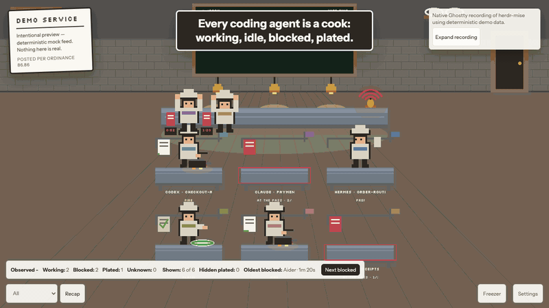
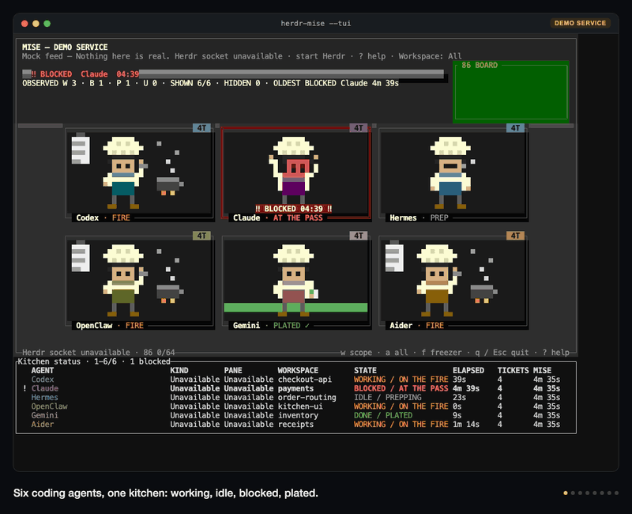
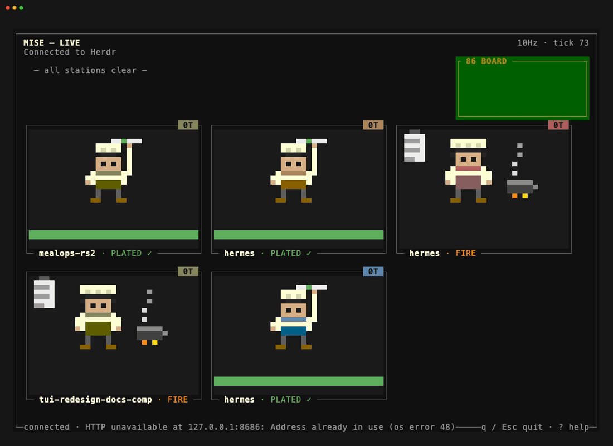
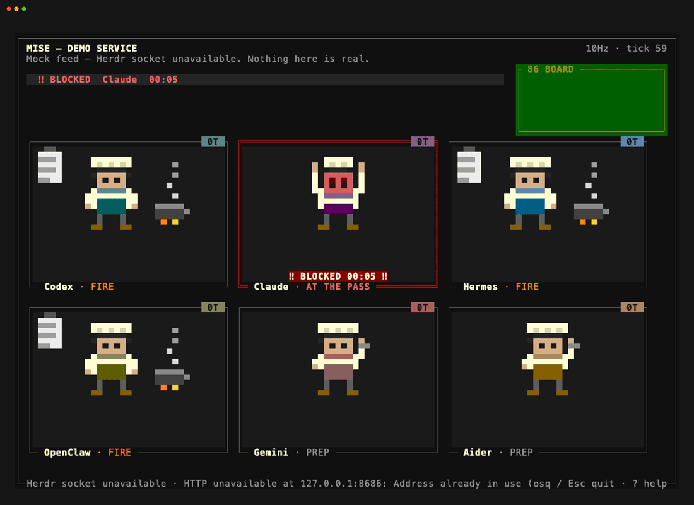
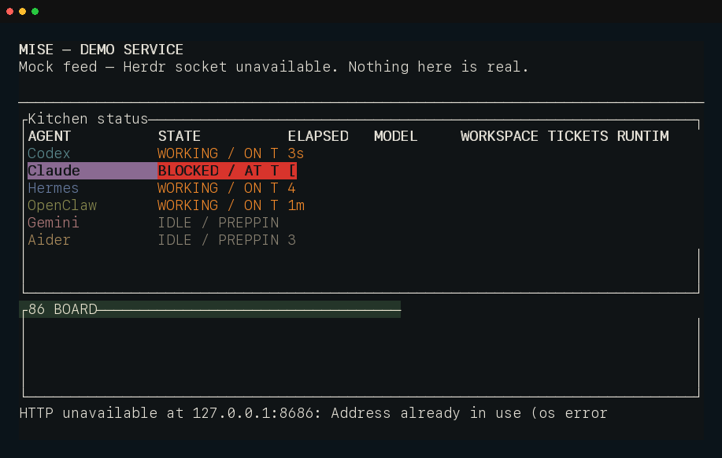
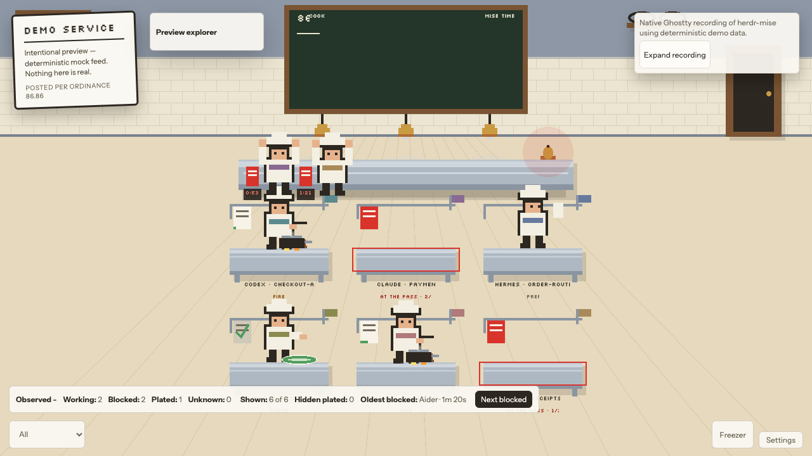
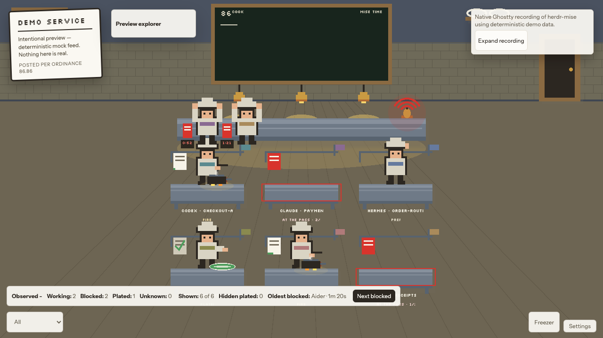
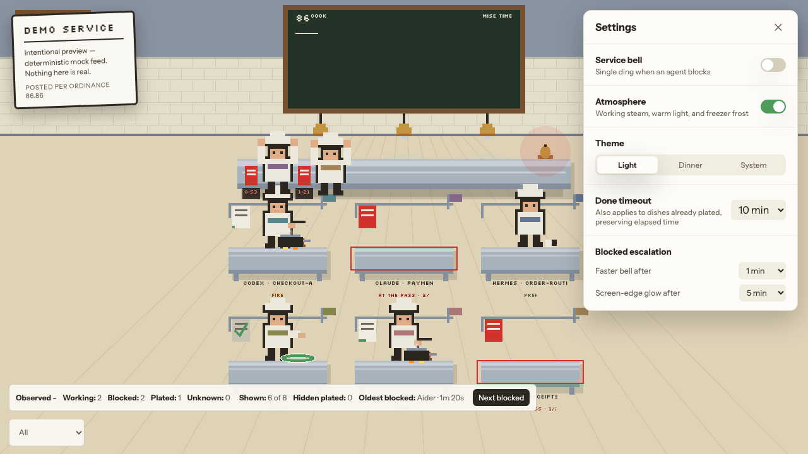

# herdr-mise

Your AI coding agents as pixel-art line cooks in one restaurant kitchen. Agent
state, the ticket rail, the pass, the 86 board, and the kitchen lights are a
glanceable, read-only skin over local Herdr state. It is a window, not an
office.

<picture>
  <source media="(prefers-reduced-motion: reduce)" srcset="docs/assets/herdr-mise-hero-poster.png">
  
</picture>

[Try the playground](https://herdr-mise.s11a.com/) ·
[75-second walkthrough](docs/assets/herdr-mise-product-demo.mp4) ·
[feature loops](docs/product-demo.md)

> IT's RAW!
>
> — _Gordon Ramsey_

## Quick start

Install Herdr, install this community plugin, and open its pane:

```sh
brew install herdr
herdr plugin install funsaized/herdr-mise
herdr plugin action invoke open --plugin mise.kitchen
```

To run without the plugin, install the standalone binary
([v0.7.0](https://github.com/funsaized/herdr-mise/releases/tag/v0.7.0))
and start the terminal kitchen:

```sh
curl -fsSL https://raw.githubusercontent.com/funsaized/herdr-mise/main/install.sh | sh
herdr-mise --tui
```

Or with Homebrew/Linuxbrew (installs `herdr`, but registers no plugin):

```sh
brew install funsaized/tap/herdr-mise
```

## Terminal UI

`herdr-mise --tui` runs the same kitchen in an integrated terminal view. These
chefs are lower level, so they are relegated to primitive kitchen tools:

<picture>
  <source media="(prefers-reduced-motion: reduce)" srcset="docs/assets/herdr-mise-tui-demo-poster.png">
  
</picture>

[MP4](docs/assets/herdr-mise-tui-demo.mp4) ·
[WebM](docs/assets/herdr-mise-tui-demo.webm) ·
[captions](docs/assets/herdr-mise-tui-demo.vtt)

| Live kitchen                                                                                           | Blocked at the pass                                                                                                                                         | Compact fallback                                                                                                                     |
| ------------------------------------------------------------------------------------------------------ | ----------------------------------------------------------------------------------------------------------------------------------------------------------- | ------------------------------------------------------------------------------------------------------------------------------------ |
|  |  |  |

## Browser UI

`herdr-mise` serves the browser kitchen on <http://127.0.0.1:8686>. In the
[playground](https://herdr-mise.s11a.com/), pick a scene and roster, then share
the URL ([local use](docs/operations.md#visual-playground)). Demo recordings, the
playground, and static fallbacks are labeled `DEMO SERVICE`.

| Mixed lunch service                                                                                                            | Mixed dinner service                                                                                                                      | Settings                                                                                  |
| ------------------------------------------------------------------------------------------------------------------------------ | ----------------------------------------------------------------------------------------------------------------------------------------- | ----------------------------------------------------------------------------------------- |
|  |  |  |

## Connecting to Herdr

### First live connection

Start Herdr (`herdr`), then open Mise through the plugin, `herdr-mise` for the
browser, or `herdr-mise --tui` for the terminal.

If you see demo instead of live state, run `herdr-mise --diagnostic`.

- **Live:** connected to Herdr, with no `DEMO SERVICE` placard.
- **Demo:** `DEMO SERVICE` identifies mock data and explains why the source is
  unavailable.
- **Connected but empty:** `Waiting for agents — start one in herdr` means the
  source is live, but has no agents. Start an agent in Herdr, not another Mise.

Troubleshooting: [Herdr socket unavailable](docs/operations.md#herdr-socket-unavailable),
[Herdr protocol not supported](docs/operations.md#herdr-protocol-not-supported).

### Herdr compatibility

These Herdr versions and protocols are verified. Other versions using the same
protocols may work but have not been verified.

<!-- herdr-compatibility:start -->

| Herdr release                | Snapshot protocol |
| ---------------------------- | ----------------- |
| `0.7.5`                      | `17`              |
| `0.8.0`                      | `19`              |
| `0.8.2`                      | `20`              |
| `0.8.2 (development commit)` | `21`              |
| `0.9.0`                      | `22`              |

<!-- herdr-compatibility:end -->

[compatibility/herdr.json](compatibility/herdr.json) records the upstream
commits and sanitized fixtures. Check them with
`npm run check:herdr-compatibility`.

### Relationship

herdr-mise is an **independent community project**, unaffiliated with the
Herdr team.

## What it is

- A single static binary serving a TypeScript browser client on
  `http://127.0.0.1:8686` and, with `--tui`, a native terminal kitchen.
- A read-only projection of local Herdr state. It does not approve, prompt,
  kill, or inspect agent output.
- A single-machine tool, not a remote dashboard, notification inbox, session
  log, or multi-host aggregator.

Blocked work stays visible, and resource use stays bounded during all-day use.
See [Browser and TUI scene parity](docs/tui-scene-parity.md).

## Runtime modes

- **Demo:** deterministic cooks remain visibly labeled while the server retries
  a missing, timed-out, unsupported, or incompatible Herdr source.
- **Live:** a compatible Herdr snapshot replaces the demo roster without a
  restart.
- **Disconnected:** a lost browser connection shows
  `GAS LEAK — SERVICE SUSPENDED` while reconnecting. Rejected updates also
  trigger reconnection; repeated rejection is labeled as an incompatible
  browser-to-Mise feed.
- **Empty:** a live source with no agents shows `Waiting for agents — start one
  in herdr.`

## Local development

Install dependencies once:

```sh
npm ci
npm ci --prefix client
```

Use the client-only playground for visual work:

```sh
npm run dev:visual
# open http://localhost:8686
```

Build the embedded client and release binary for integration work:

```sh
npm run bundle
HERDR_SOCKET_PATH=/tmp/no-herdr.sock ./target/release/herdr-mise
# or run the terminal kitchen:
./target/release/herdr-mise --tui
```

See [Client development](docs/operations.md#client-development) for playground
presets, isolation guarantees, and plain Vite limitations.

### Contributor plugin development

To exercise the published-binary plugin manifest from a checkout, link it:

```sh
herdr plugin link .
herdr plugin action invoke open --plugin mise.kitchen
```

The browser service continues alongside the TUI when its loopback port is free
(`8686` by default, or `HERDR_MISE_PORT`).

## Security and limitations

- The server binds only to `127.0.0.1`, on `8686` by default;
  `HERDR_MISE_PORT` changes only that loopback port. Browser WebSocket origins
  must match the effective port or be explicitly added for a personal reverse
  proxy, which owns its transport and access control.
- The binary sends no telemetry or outbound network requests. Live mode reads
  only the local Herdr Unix socket.
- Release archives and the installer support macOS arm64, macOS x86_64, and
  Linux x86_64 glibc: `aarch64-apple-darwin`, `x86_64-apple-darwin`, and
  `x86_64-unknown-linux-gnu`. Linux uses the Ubuntu 24.04 / glibc 2.39 baseline;
  older glibc, musl, Windows, and Linux ARM are not claimed supported.
  There is no background service or auto-update.
- Browser settings are local site data. Reduced motion is honored.

See [Security policy](SECURITY.md) and [Operations](docs/operations.md) for
details and troubleshooting.

## Documentation

- [GitHub issues](https://github.com/funsaized/herdr-mise/issues) — accepted
  work, ownership, and current status.
- [Architecture](docs/architecture.md) — components, data flow, and trust
  boundaries.
- [Operations](docs/operations.md) — run, develop, diagnose, and troubleshoot.
- [Release operations](docs/releasing.md) — signing, publication, and recovery.
- [Product demo media](docs/product-demo.md) — how the README, playground, and
  terminal recordings are captured, re-recorded, and validated.
- [Contributing](CONTRIBUTING.md) — setup, verification, and review rules.
- [Security policy](SECURITY.md) — supported versions and private reporting.
